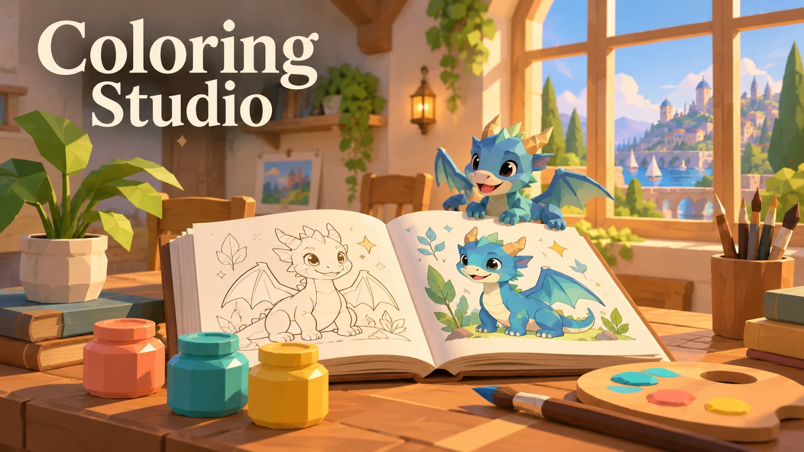
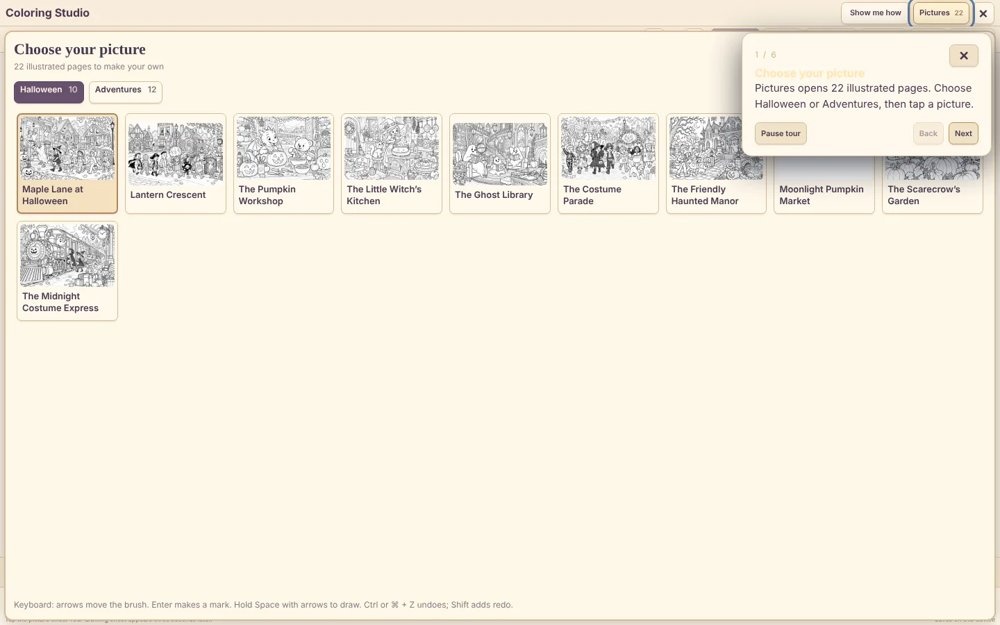
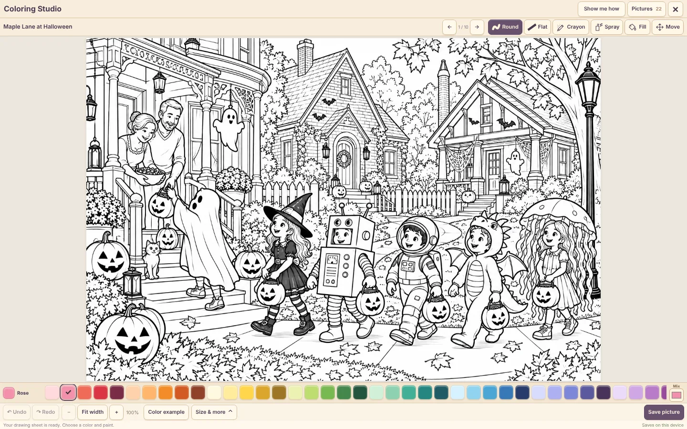
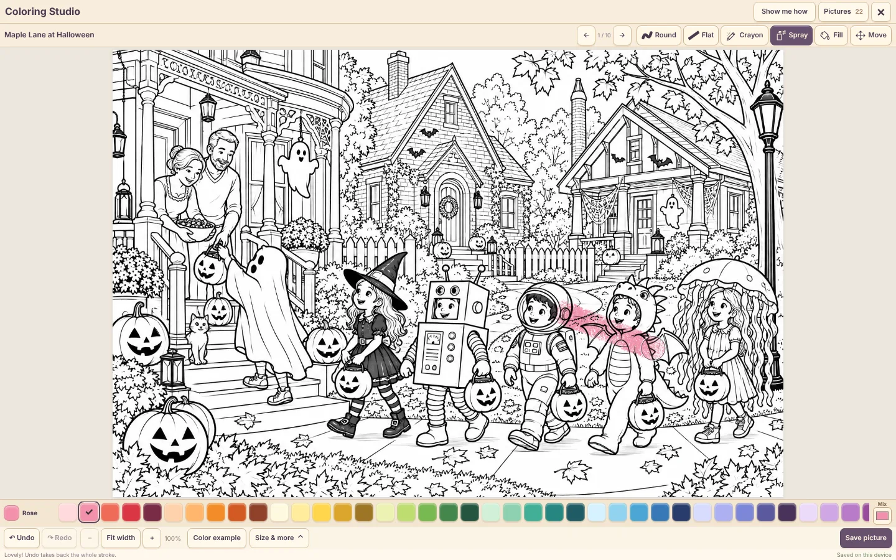
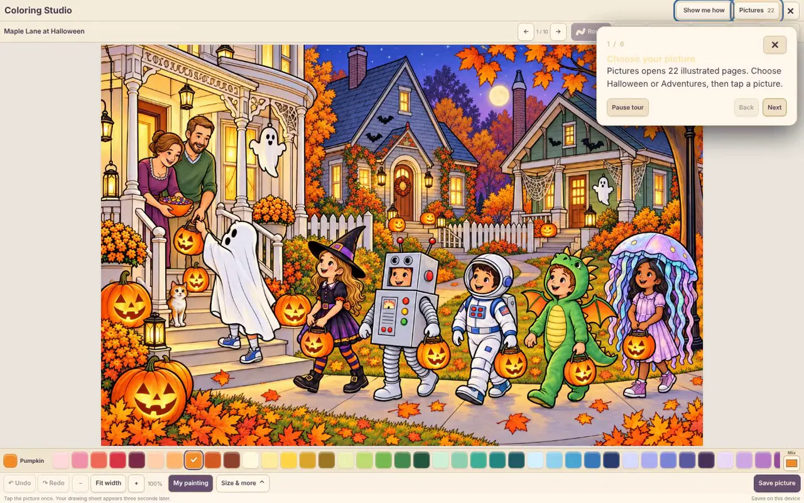

# Coloring Studio

**22 illustrated sheets, 60 colors and a compact paint box.**

[**▶ Live demo**](https://beebopcat.github.io/coloring-studio/) · [**Play on caseyshingledecker.com**](https://caseyshingledecker.com/demos/top-secret/pocket-dragon/) · [**Source**](https://github.com/Beebopcat/coloring-studio)

[](https://beebopcat.github.io/coloring-studio/)

> **Status:** playable in your browser on GitHub Pages and caseyshingledecker.com.

## What it is

A children's coloring studio with 22 illustrated pictures, 60 colors and a compact paint box. Pick a picture, choose your paints and make it your own.

## Screenshots

| | |
|:--:|:--:|
|  |  |
| <sub>Coloring Studio open on the full-color Maple Lane at Halloween picture, with a tour bubble at the top right.</sub> | <sub>Choose your picture panel listing Halloween pages such as Maple Lane at Halloween, Lantern Crescent and The Pumpkin Workshop.</sub> |
|  |  |
| <sub>Black-and-white Halloween street scene with a rose-colored crayon stroke across the costumed kids.</sub> | <sub>Line-art Halloween scene with pink spray-paint strokes across the costumed kids and the Spray tool selected.</sub> |

### Video

[](docs/media/clip.mp4)

*Click the poster to open the short screen recording (docs/media/clip.mp4).*

## How to use

1. Open your picture. "Show me how" gives a short guide.
2. Choose a drawing tool (brush, crayon, spray or fill), a color and a stroke size.
3. Color the picture.
4. Save a copy or print your artwork. Your pictures stay on this device.

### Quick start


<sub>Line-art Halloween scene with pink spray-paint strokes across the costumed kids and the Spray tool selected.</sub>

## Features

- 22 pictures and 60 colors
- Tools: brush, crayon, spray and fill
- Save a copy or print
- Seasonal and Halloween-themed sheets (for example Pumpkin Workshop, Ghost Library, Haunted Manor and Midnight Costume Express) alongside orchard, space, ocean, forest, snow and toy-room scenes
- Full-color inspiration examples for each sheet
- Your pictures stay on this device

## The story behind it

Part of Casey's Arcade, and separate from the horror books. Characters from the Pocket Dragon world, such as Pip and Poppy, appear in some sheet names. Your pictures stay on this device.

## Built with

- HTML and canvas JavaScript
- WebP illustration assets

## Run it locally

This is a static web project, so any local web server works:

```bash
git clone https://github.com/Beebopcat/coloring-studio.git
cd coloring-studio
python -m http.server 8000
```

Then open http://localhost:8000 in your browser.

## Credits & disclaimers

Built by Casey Shingledecker with AI-assisted development.

## More projects

- Portfolio and live demos: https://caseyshingledecker.com/
- All repositories: https://github.com/Beebopcat

## License

Copyright (c) 2026 Casey Shingledecker. All rights reserved. Source-available for viewing and for personal, non-commercial running only; this is not open source. See [LICENSE](LICENSE). See also [NOTICE.md](NOTICE.md). Other people's material keeps its own license.
